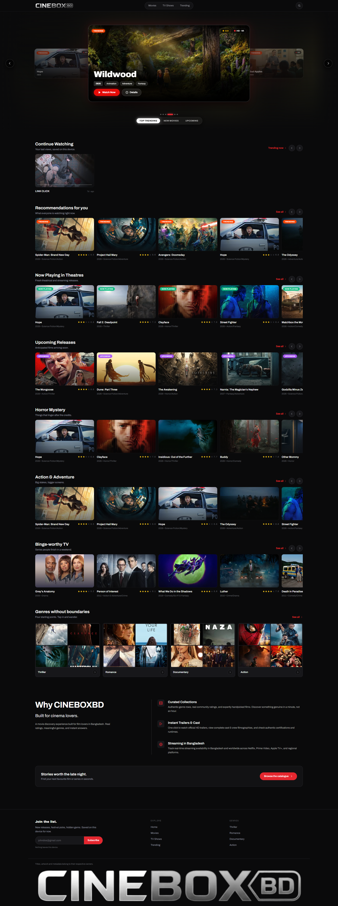

# MOVIEBOXBD



A movie & TV discovery website built with **Next.js 16.4** (App Router + Cache Components), **Tailwind CSS v4**, and the **TMDB API** — no dummy data anywhere: every title, poster, rating, certification and trailer is fetched live.

## Getting started

### 1. Get a TMDB API key

Free at <https://www.themoviedb.org/settings/api> — a v3 API key or a v4 read access token both work.

### 2. Configure environment

Copy `.env.example` to `.env.local` and fill in your credentials:

```env
# either one works
TMDB_READ_ACCESS_TOKEN=your_v4_token
TMDB_API_KEY=your_v3_key
```

### 3. Install & run

```bash
npm install
npm run dev
```

The dev server runs on **http://localhost:4080** (port is set in `package.json`). Without credentials the site renders a setup notice instead of content.

## Scripts

| Command | Description |
| --- | --- |
| `npm run dev` | Dev server on port 4080 (Turbopack) |
| `npm run build` | Production build |
| `npm run start` | Serve production build on port 4080 |
| `npm run lint` | ESLint |

## Project structure

```
src/
├── app/                   # App Router routes
│   ├── page.js            # Home (hero, continue watching, curated rows, genres, CTA)
│   ├── movies/ tv/        # Browse w/ genre, sort, search, grid/list, pagination
│   ├── movie/[id] tv/[id] # Detail pages (facts, cast, trailer, recommendations)
│   ├── search/            # Search + trending
│   ├── loading.js error.js not-found.js
├── components/
│   ├── layout/            # SiteHeader, PillNav, HeaderSearch, MobileNav (drawer), SiteFooter
│   ├── home/              # NowWatchingHero, ContinueWatchingRow, ExploreBar, collages, CTA
│   ├── media/             # MediaCard, PosterCard, ListCard, Carousel, ScrollShell
│   ├── browse/            # BrowseCollection, FilterToolbar, Pagination
│   ├── detail/            # DetailHero, CastRow, FactsGrid, TrailerModal, HistoryTracker
│   └── ui/                # SectionHeading, Skeleton, EmptyState, ApiKeyNotice
├── lib/
│   ├── tmdb/              # client (cached fetch + auth), endpoints, normalizers
│   ├── images.js format.js watchlist.js cn.js
└── config/site.js         # nav, genre rows, sort maps
```

## Key decisions

- **Data fetching:** all reads happen in Server Components through `'use cache'` functions (`cacheLife`/`cacheTag` — the Next 16 Cache Components model), deduplicated with `Promise.all`.
- **Auth:** works with either a v3 `api_key` or a v4 `Authorization: Bearer` token.
- **Images:** `next/image` with `remotePatterns` for the image CDN, responsive `sizes`, `preload` on hero/detail backdrops.
- **State:** only interactive islands are client components (carousels, filters, search overlay, trailer modal, mobile drawer). "Continue Watching" uses real `localStorage` history — no fabricated entries.
- **Design:** dark cinema palette (near-black + single red accent + gold ratings), Archivo / Archivo Black / Geist Mono typography; gradients used **only** as legibility scrims over photos.
- **Branding:** the public UI is provider-neutral — no data-source branding is rendered anywhere in the frontend.

## Branding & attribution (owner note)

The rendered frontend intentionally contains no provider branding. Per TMDB's API terms, the required attribution is kept here (in docs, not in the UI) so you can decide where it belongs:

> This product uses the TMDB API but is not endorsed or certified by TMDB.
